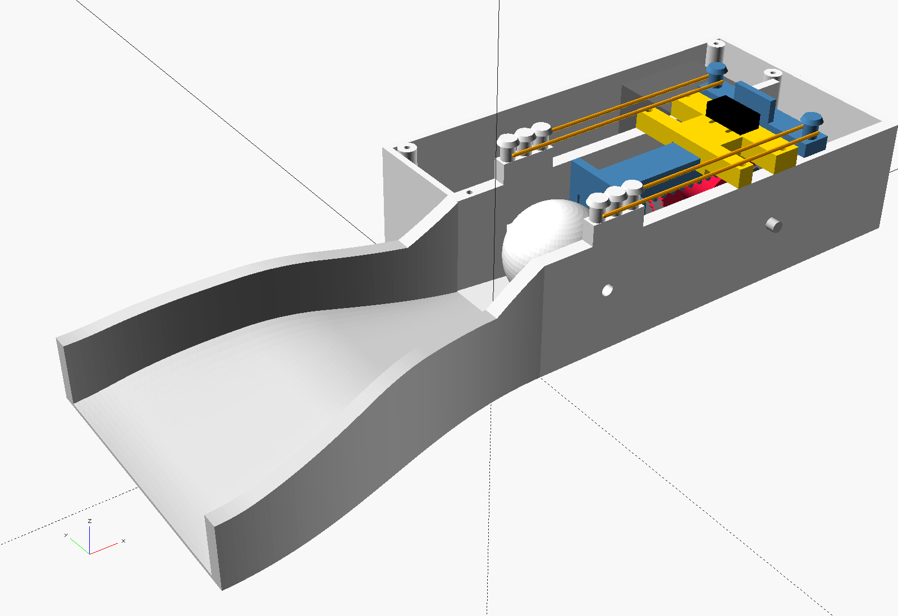
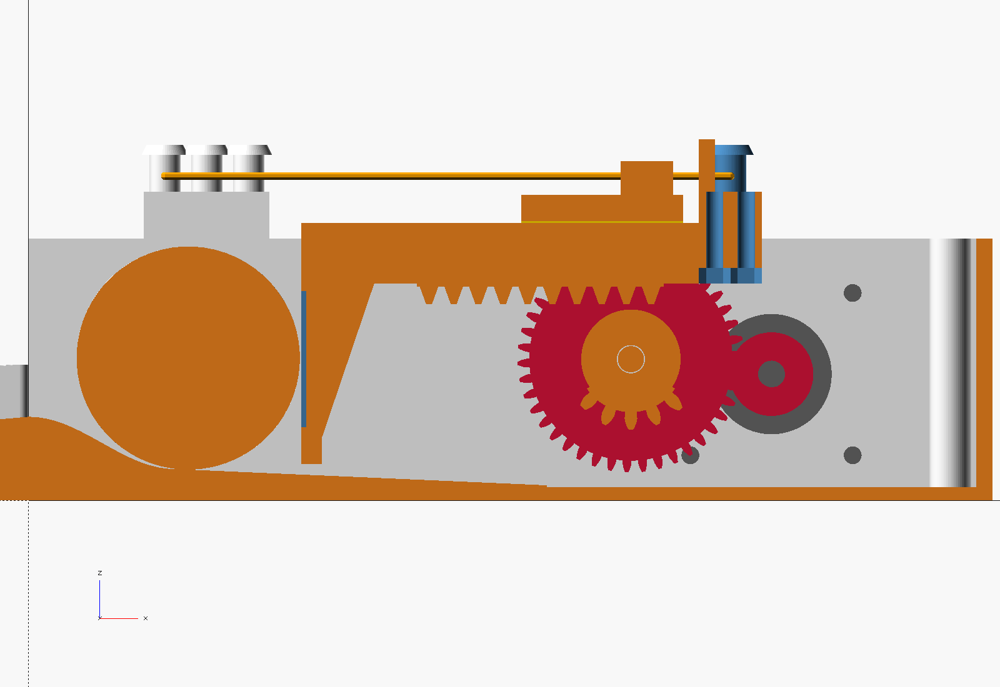
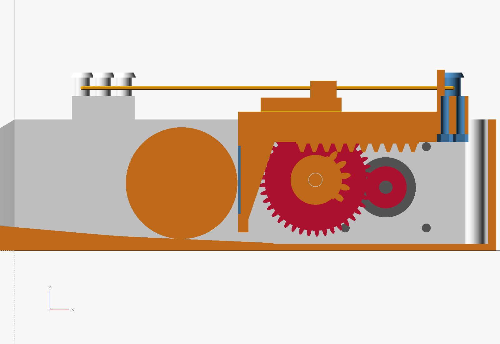
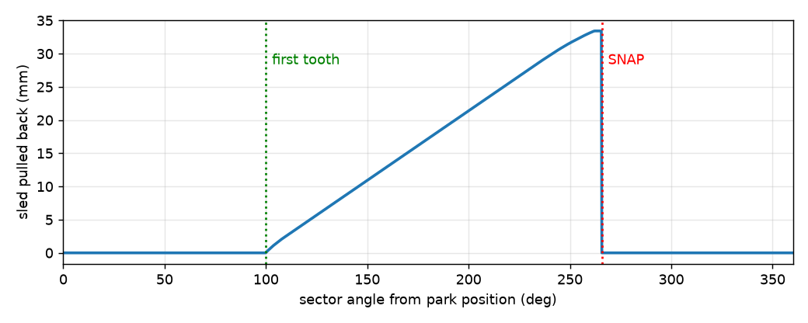

# Automatic Putting-Cup Ball Return (rubber-band snap kicker)

A 3D-printable clone of the "automatic putting cup return / gravity sensor golf
ball trainer". The ball rolls up a ramp into a pocket. A sensor sees it, and a
motor turns a **sector gear** (a gear with most of its teeth removed). The
sector drags a **gear rack** on a sled back against **rubber bands**. When the
last tooth slips off the rack, the bands snap the paddle forward and kick the
ball back down the ramp to you.



| Ready (sled forward, toothless arc up) | Cocked (last tooth about to slip off) |
|---|---|
|  |  |



## How it works

1. The ball climbs a 5° ramp (16 mm high). The ramp has a funnel as wide as a real 108 mm cup.
2. It drops into a 10 mm deep pocket. The pocket floor slopes 2.5° toward the paddle, so the ball always settles against it.
3. An IR sensor in the pocket wall (TCRT5000) sees the ball. The firmware waits 0.45 s for the ball to settle.
4. The stepper turns one revolution of the sector. That is 5,600 micro-steps, about 1.2 s.
   - **0–100°:** the toothless arc passes under the rack and nothing moves.
   - **100–266°:** five teeth drag the sled back 33 mm and stretch the bands. The ball rolls back with the paddle.
   - **266°:** the last tooth slips off and the bands fire the sled forward. The paddle pushes the ball up out of the pocket.
   - **266–360°:** the sector parks with its toothless arc under the rack.
5. A microswitch on the guide rail confirms the sled snapped home. The firmware uses that to re-sync every cycle and to detect jams.

## Why the stepper and not the 9 g servo

Output of `docs/band_calc.py`, for a #32-size band (50 mm circle, 75 mm flat).
"Bands" counts loops in total, split evenly between the two sides.

| Preload hole | Bands | Force at full pull | Stored energy | Peak torque at sector | Peak torque at motor (3.5:1) |
|---|---|---|---|---|---|
| rear (x=42) | 2 | 7.1 N | 0.18 J | 9.2 N·cm | 3.1 N·cm |
| rear (x=42) | 4 | 14.1 N | 0.36 J | 17.2 N·cm | 5.8 N·cm |
| front (x=26) | 4 | 16.9 N | 0.47 J | 20.9 N·cm | 7.0 N·cm |
| front (x=26) | 6 | 25.3 N | 0.70 J | 30.5 N·cm | 10.2 N·cm |

- **A standard SG90 can't drive this at all.** It only turns about 180°, and a sector gear needs to spin continuously. On the way back it would jam the teeth into the rack.
- **A continuous-rotation 9 g servo would be marginal driving the sector directly.** Two bands already need 9–11 N·cm, and these servos stall around 12–15 N·cm in practice.
- **The 17HS4401S through the printed 3.5:1 gearbox has 3× margin or better.** It produces roughly 20 N·cm at 1 A and 180 rpm. The worst case above needs 10 N·cm at the motor. Your "20 mm shaft" is the shaft length; the diameter is 5 mm with a D-flat, and the pinion is bored for that.

Return speed and distance depend on the surface. The script assumes a stimp-10 green with no impact losses, so it gives an upper bound. **Start with 2 bands on the rear holes, then add bands until the ball comes back far enough.**

## Printed parts

STLs are in `stl/`, already in print orientation, and none need supports. Use PLA or PETG with 0.2 mm layers. [`golf_ball_return_stl.zip`](golf_ball_return_stl.zip) has all of them plus a print guide in one download.

| Part | Qty | Notes |
|---|---|---|
| `base.stl` | 1 | 184 × 108 mm footprint. 3 walls, 15 % infill. The pocket floor is solid, so infill keeps it light. |
| `ramp.stl` | 1 | 182 × 114 mm including dovetails. 2 walls, 10 % infill. |
| `sled.stl` | 1 | Prints upside down on its flat top. 4 walls, 30 % infill. Keep it light, because sled mass robs kick energy. |
| `crossbar.stl` | 1 | Carries the sled-side band pins and the switch striker. 4 walls, 40 % infill. |
| `guide.stl` | 1 | Inverted C-channel, printed upside down. Its rear face is the sled's front stop. |
| `sector.stl` | 1 | 42T m1 gear + 5-tooth 16T m1.5 sector, printed big-gear-down. 4 walls, 50 % infill. |
| `pinion.stl` | 1 | 12T m1, D-bore for the 5 mm shaft, M3 grub screw. 100 % infill. |
| `spacer.stl` | 1 | Sits on the axle between the 42T gear and the motor plate. |
| `lid.stl` | 1 | Covers the electronics and motor bay. |

## Hardware

| Item | Qty |
|---|---|
| Usongshine 17HS4401S NEMA17 stepper | 1 |
| A4988 or DRV8825 driver module + 100 µF / 25 V capacitor | 1 |
| Arduino Nano (ATmega328P) + 4 × 6 cm perfboard + female headers | 1 |
| TCRT5000 IR reflective sensor module (digital "DO" output) | 1 |
| KW11-3Z lever microswitch (20 × 10 × 6.4 mm) | 1 |
| 12 V 2 A DC adapter, 5.5 × 2.1 panel jack (11 mm hole), KCD1 rocker switch | 1 each |
| M5 × 65–70 bolt, nut, 2 washers (sector axle) | 1 |
| M3 × 8 (motor) | 4 |
| M3 × 16 self-tapping screws (guide rail into the printed walls) | 4 |
| M3 × 20 + nuts (crossbar to sled) | 2 |
| M3 × 8 (lid), M2.5 × 6 (perfboard), M2 × 10 (microswitch) | 4, 4, 2 |
| M3 × 4 grub screw + M3 nut (pinion) | 1 |
| #32 rubber bands (≈ 50 mm circle / 75 mm flat) | 2–6 |
| 3 mm rubber or TPU pad, about 20 × 60 mm, for the front-stop bumper | 1 |
| Felt or foam pad, 30 × 26 mm, for the paddle face | 1 |
| 10 mm stick-on rubber feet | 4 |
| Optional: active 5 V buzzer, momentary push button | 1 each |

## Wiring

See [docs/WIRING.md](docs/WIRING.md) for the full diagram. In short:

| From | To |
|---|---|
| 12 V jack → rocker switch | A4988 VMOT (100 µF across VMOT/GND), Nano VIN |
| Nano D4 / D5 / D6 | A4988 STEP / DIR / EN |
| A4988 MS1, MS2 | 5 V (1/8 micro-stepping). MS3 to GND. RESET jumpered to SLEEP. |
| TCRT5000 DO | D2 (VCC 5 V, GND) |
| Guide-rail microswitch COM / NO | GND / D3 |
| Pause button | D8 to GND |
| Buzzer + | D9 |

**Set the driver current before connecting the motor.** Aim for about 0.9 A. On an A4988 with R100 sense resistors that is Vref = 0.72 V. On a DRV8825 it is 0.45 V.

## Assembly

1. **Gearbox.** Push the pinion onto the motor shaft until its hub almost touches the motor plate, then lock the grub screw on the flat. Bolt the motor to the plate with 4 × M3 × 8.
2. **Sector.** Slide the M5 bolt in through the hole in the outer wall. Thread on the sector with its long tube toward the wall, then the spacer. Push the bolt through the motor plate and add the nut. Snug it so the sector spins freely without wobble.
3. **Sled.** Slide the guide rail onto the beam from the rear end. Drop the sled into the channel and screw the rail down with 4 × M3 × 16.
4. **Crossbar.** Put two M3 nuts in the hex pockets under the beam and screw the crossbar on with M3 × 20.
5. **Front stop.** Glue the 3 mm bumper pad to the rear face of the guide rail. **Check the phase:** with the sled resting on the bumper, turn the sector by hand. The first tooth must drop into a rack gap without hitting a tooth tip. The design tolerates −1.5 to +2 mm of bumper error. If the tooth clips, make the bumper 1 mm thicker or thinner.
6. **Home switch.** Screw the microswitch to the slots on top of the rail with its lever toward the crossbar. Slide it so it clicks in the last 1–2 mm before the crossbar reaches the bumper.
7. **Bands.** Loop one band over a frame pin and the matching crossbar pin on each side. The three frame pins set the preload; the front pin is strongest.
8. **Sensor.** Rest the TCRT5000 board on the shelf behind the pocket window with the IR pair looking through it. Hot glue it in place. Turn its trimmer until the module LED lights only when a ball sits against the paddle.
9. **Electronics.** Mount the perfboard on the standoffs, wire per the table, flash the firmware, and fit the lid.
10. **Ramp.** Slide the ramp's dovetails into the base from below.

## Firmware

The sketch is `firmware/golf_returner/golf_returner.ino`. It has no library dependencies and compiles for an Arduino Nano at about 5 KB. Settings are at the top of the file:

| Setting | Default | Change it when |
|---|---|---|
| `DIR_INVERT` | 0 | The sector pushes the rack into the stop instead of pulling it back. |
| `BALL_ACTIVE_LOW` | 1 | You use a sensor whose output goes HIGH when it sees the ball. |
| `USE_HOME_SWITCH` | 1 | You leave out the microswitch. The firmware then just counts one revolution. |
| `BALL_SETTLE_MS` | 450 | You want a faster or slower return. |
| `SPEED_MAX` | 4800 | You want to change cocking speed, in micro-steps per second. |
| `MAX_RETRIES` | 3 | You want more kicks before giving up on a stuck ball. |

At power-up the firmware fires one empty kick to sync the gear. If it never sees the sled snap within 1.3 revolutions, it stops, beeps three times, and waits. The pause button toggles auto-return and also clears a fault.

## Tuning and troubleshooting

- **The ball doesn't come back far enough.** Add bands or move them to a more forward frame pin.
- **The ball comes back too hard or bounces out of the pocket.** Remove bands, add the felt pad on the paddle, or lower `SPEED_MAX`. Speed doesn't change kick strength, but slower is quieter.
- **The sled stalls while cocking.** Raise the driver current, add a little PTFE dry lube to the rail, or use fewer bands.
- **Kicks fire with no ball.** Turn the TCRT5000 trimmer down. Strong sunlight outdoors can blind it; shade the window or use an IR break-beam pair through the 5 mm hole in the opposite wall.

## Editing the design

Everything is parametric in `cad/golf_returner.scad` and uses OpenSCAD 2021.01 or newer.

```bash
cad/build.sh                 # export all STLs, the zip and render images
cad/build.sh sled            # export one part
cad/check.sh                 # interference check across the kick cycle
python3 docs/sector_sim.py   # re-simulate sector/rack contact, regenerates cad/stroke_table.scad
python3 docs/band_calc.py    # band force / energy / torque table
```

`sector_sim.py` is the reference for the sector and rack. It finds where the rack sits at every 0.25° of sector rotation. That gives the stroke, the snap angle, the lever arm, and how much bumper error the first tooth tolerates. If you change the teeth, module, or rack phase, re-run it.

## Safety

Cocked bands store up to 0.7 J. Keep fingers out of the paddle path and the gear mesh, and switch off the power before reaching in.
